# Diagramme de Séquence - Scénario Pandemic

Ce document décrit le déroulement complet du jeu **Scénario Pandemic** (version championnat du monde).
Le diagramme ci-dessous utilise la syntaxe **Mermaid**. Pour le visualiser, ouvrez ce fichier dans un
éditeur supportant Mermaid (VS Code avec extension, GitHub, etc.) ou copiez-le dans
https://mermaid.live.

---

## Diagramme Mermaid

```mermaid
sequenceDiagram
    participant Joueur as 👤 Joueur
    participant Index as 📄 index.html
    participant Prepare as ⚙️ prepare.js
    participant Game as 🎮 game.html
    participant GameJS as ⚙️ game.js
    participant Cards as 🃏 cards.js
    participant Timer as ⏱️ minuteur.js
    participant Display as 🖥️ DOM/Affichage
    participant PressePapier as 📋 Presse-papier

    Note over Joueur,PressePapier: ════════════ PHASE 1 : SÉLECTION DES RÔLES ════════════

    Joueur->>Index: Ouvre index.html
    Index->>Cards: Charge constantes (roles, cartes villes, évènements, épidémies)
    Index->>Prepare: run() – Affiche les cases à cocher des personnages
    Joueur->>Prepare: Choisit 0, 1 ou 2 rôles + clique "Start"
    Prepare->>Prepare: get_roles() – Valide la sélection
    alt Rôles manquants
        Prepare->>Cards: shuffle(roles) pour compléter aléatoirement
    end
    Prepare->>Index: Redirige vers game.html?roleJoueur1=X&roleJoueur2=Y

    Note over Joueur,PressePapier: ════════════ PHASE 2 : INITIALISATION DE LA PARTIE ════════════

    Joueur->>Game: game.html chargé (body onload = run())
    Game->>GameJS: run()
    GameJS->>GameJS: Parse les paramètres URL (roles, paquetJoueur, paquetPropagationEntier, pseudos, idUnique)
    
    alt Paramètres fournis (scénario rejoué)
        GameJS->>GameJS: Utilise les paquets passés en paramètre
    else Nouvelle partie
        GameJS->>Cards: Récupère les tableaux bleu, jaune, noir, rouge, evenements, epidemies
        GameJS->>Cards: shuffle(evenements) – ne garde que 5 évènements
        GameJS->>GameJS: Concatène toutes les cartes villes + 5 évènements
        GameJS->>Cards: shuffle(paquetJoueur)
        GameJS->>GameJS: Insère 6 épidémies à positions aléatoires dans le paquet joueur
        GameJS->>GameJS: preparationPaquetPropagations()
        Note over GameJS: Parcourt le paquet joueur :<br/>- Tire 9 cartes de propagation initiales<br/>- Pour chaque paire de cartes joueur :<br/>  - Si épidémie détectée → pioche sous le paquet,<br/>    mélange défausse, remet au-dessus<br/>  - Tire X cartes de propagation selon le nb d'épidémies
    end

    alt Premier joueur
        GameJS->>GameJS: idUnique = Date.now()
        GameJS->>Display: alert("1er à jouer ce scénario")
    else Joueurs précédents
        GameJS->>Display: alert("N joueurs ont déjà joué : ...")
    end

    GameJS->>GameJS: Construit lienSansPseudo
    GameJS->>Display: miseEnPlaceJoueur('idJoueur1') – 4 cartes + rôle + image
    GameJS->>Display: miseEnPlaceJoueur('idJoueur2') – 4 cartes + rôle + image
    GameJS->>Display: Affiche spoilers paquets (cachés par défaut)
    Game->>Timer: resetTimer() – Initialisation du minuteur

    Note over Joueur,PressePapier: ════════════ PHASE 3 : BOUCLE DE JEU (TOURS) ════════════

    loop Pour chaque tour (nbTours de 1 à ~26)
        
        Note over Joueur,PressePapier: ─── 3a. Phase de tirage Joueur ───
        
        Joueur->>Game: Clique "Tirer 1ère carte"
        Game->>GameJS: tirerCartes('idCarte1')
        GameJS->>GameJS: paquetJoueur.shift() – pioche une carte
        alt Paquet vide
            GameJS->>Display: alert("Perdu ! Plus de cartes")
            GameJS->>GameJS: Désactive boutons, retour
        end
        GameJS->>Display: Affiche la carte avec sa couleur
        GameJS->>Display: Ajoute au récapitulatif
        GameJS->>GameJS: isPseudoGagnePerduCeTour("J")
        Note over GameJS: Vérifie si un joueur historique a gagné à ce tour
        GameJS->>Display: Active bouton "Tirer 2nde carte", désactive le 1er
        Joueur->>Game: Clique "Tirer 2nde carte"
        Game->>GameJS: tirerCartes('idCarte2')
        GameJS->>GameJS: pioche 2ème carte, même logique
        GameJS->>Display: Active bouton propagation

        Note over Joueur,PressePapier: ─── 3b. Phase de chrono ───

        Joueur->>Game: Clique "▶ Nouveau tour" (bouton unique)
        Game->>GameJS: boutonUnique()
        GameJS->>GameJS: nouveauTour() – nbTours++
        GameJS->>Timer: startTimerDuree(120s tour1 / 80s suivants)
        Timer->>Timer: Compte à rebours
        GameJS->>Display: Le bouton affiche "⏸ MM:SS"
        Timer->>Timer: À 0 – beep()
        Note over Joueur: En cas de problème : clic pendant le décompte<br/>→ pause + menu (Reset / Reprise / Stop)

        Note over Joueur,PressePapier: ─── 3c. Phase de propagation ───

        Joueur->>Game: Clique "Tirer carte propagation"
        Game->>GameJS: tournePropogation()
        GameJS->>GameJS: nbCartesPropagationTournees++
        GameJS->>GameJS: paquetPropagationEntier.shift() – pioche carte
        GameJS->>Display: Affiche la carte (ville ou épidémie) avec couleur
        GameJS->>Display: Ajoute au récapitulatif
        GameJS->>GameJS: isPseudoGagnePerduCeTour("P")
        Note over GameJS: Vérifie si un joueur historique a perdu<br/>à ce nombre de cartes propagation
        
        alt Lot de propagation terminé (ex: 2/2, 3/3, 4/4)
            GameJS->>Display: Active boutons joueur
            GameJS->>Display: Affiche "Tour : [Rôle du joueur actif]"
        else Encore des cartes à tirer
            Joueur->>Game: Clique à nouveau "Tirer carte propagation"
        end
        
        Note over Joueur: Le bouton unique "🎯" enchaîne automatiquement<br/>les actions selon l'état (Propagation / J1-J2 / Nouveau tour)
    end

    Note over Joueur,PressePapier: ════════════ PHASE 4 : FIN DE PARTIE ════════════

    Joueur->>Game: Saisit son pseudo
    Joueur->>Game: Coche "Gagnée" ou "Perdue"
    Game->>GameJS: remplirChampsFinPartie()
    GameJS->>Display: Affiche sélecteurs : nb remèdes (0-4), nb éclosions (0-8)
    alt Gagné
        GameJS->>Display: nbRemedes = 4 (par défaut)
    else Perdu
        GameJS->>Display: nbRemedes = 0 (par défaut)
    end
    Joueur->>Game: Ajuste les valeurs et clique "Partie terminée"
    Game->>GameJS: partieTerminee()
    GameJS->>GameJS: Valide pseudo et sélection gagné/perdu
    GameJS->>GameJS: Ajoute les stats au tableau pseudos[]
    alt Plusieurs joueurs ont joué
        GameJS->>Display: historiquePartie() – Tableau comparatif
    end
    GameJS->>GameJS: genererLienPartie()
    GameJS->>PressePapier: Copie le lien de la partie (inclut tous les paramètres + pseudos)
    PressePapier->>Display: alert("Lien copié !")
    Joueur->>Game: Partage le lien pour que d'autres jouent le même scénario

    Note over Joueur,PressePapier: ════════════ PHASE 5 : DEBUG / HISTORIQUE ════════════

    Joueur->>Game: Coche "debug"
    Game->>GameJS: debug()
    GameJS->>Display: Affiche/Masque le panneau debug
    Joueur->>Game: Clique "Montrer" sur "Récap des tours passés"
    GameJS->>Display: cacherAfficherCartes() – Affiche le récap détaillé
    Joueur->>Game: Clique "Montrer" sur "Spoil paquet joueur"
    GameJS->>Display: Affiche l'ordre complet du paquet joueur
    Joueur->>Game: Clique "Montrer" sur "Historique"
    GameJS->>Display: historiquePartie() – Tableau HTML de tous les joueurs
```

---

## Résumé textuel du flux

### Acteurs / Composants

| Acteur | Rôle |
|--------|------|
| **👤 Joueur** | L'utilisateur qui interagit avec l'interface |
| **📄 index.html** | Page d'accueil avec sélection des personnages |
| **⚙️ prepare.js** | Logique de sélection et validation des rôles |
| **🎮 game.html** | Page principale du jeu |
| **⚙️ game.js** | Cœur du jeu : logique des tours, tirages, propagation |
| **🃏 cards.js** | Constantes (cartes villes, évènements, épidémies, rôles) et utilitaires (shuffle, randomInt) |
| **⏱️ minuteur.js** | Chronomètre (120s/80s) avec pause/reprise |
| **🖥️ DOM/Affichage** | Interface utilisateur HTML manipulée dynamiquement |
| **📋 Presse-papier** | API de copie de lien |

### Flux principal

1. **Sélection des rôles** – Le joueur choisit 0, 1 ou 2 personnages sur `index.html`, puis est redirigé vers `game.html`.

2. **Initialisation** – `game.js` construit (ou reçoit via paramètres URL) le paquet joueur (48 cartes villes + 5 évènements + 6 épidémies insérées à positions aléatoires) et le paquet de propagation. Chaque joueur reçoit 4 cartes et un rôle. Un identifiant unique (`Date.now()`) est généré pour la partie.

3. **Boucle de jeu** (jusqu'à ~26 tours, soit ~52 cartes joueur) :
   - **Tirage joueur** : 2 cartes sont piochées une par une depuis le paquet joueur
   - **Chrono** : Minuteur de 120s (tour 1) ou 80s (tours suivants)
   - **Propagation** : Des cartes de propagation sont tirées (2 à 4 par tour selon le nombre d'épidémies déjà rencontrées). Si une épidémie est tirée, la défausse est mélangée et remise au-dessus du paquet.

4. **Fin de partie** – Le joueur enregistre son pseudo, le résultat (gagné/perdu), le nombre de remèdes (0-4) et d'éclosions (0-8). Un lien complet de la partie est copié dans le presse-papier pour partage.

5. **Debug / Historique** – Permet d'afficher les spoilers des paquets, le récapitulatif des tours, et l'historique complet de tous les joueurs ayant participé à ce scénario.

### Règles de victoire/défaite (d'après le code)

- **Perdu** : Le paquet joueur est vide → `alert("il ne reste plus de carte...")`
- **Gagné** (déduit du contexte) : Les joueurs ont trouvé les 4 remèdes
- **Comparaison historique** : `isPseudoGagnePerduCeTour()` vérifie si d'autres équipes ont gagné au même tour (carte joueur) ou perdu au même nombre de cartes propagation

---

*Généré le 2026-07-29 à partir de l'analyse du code source*
